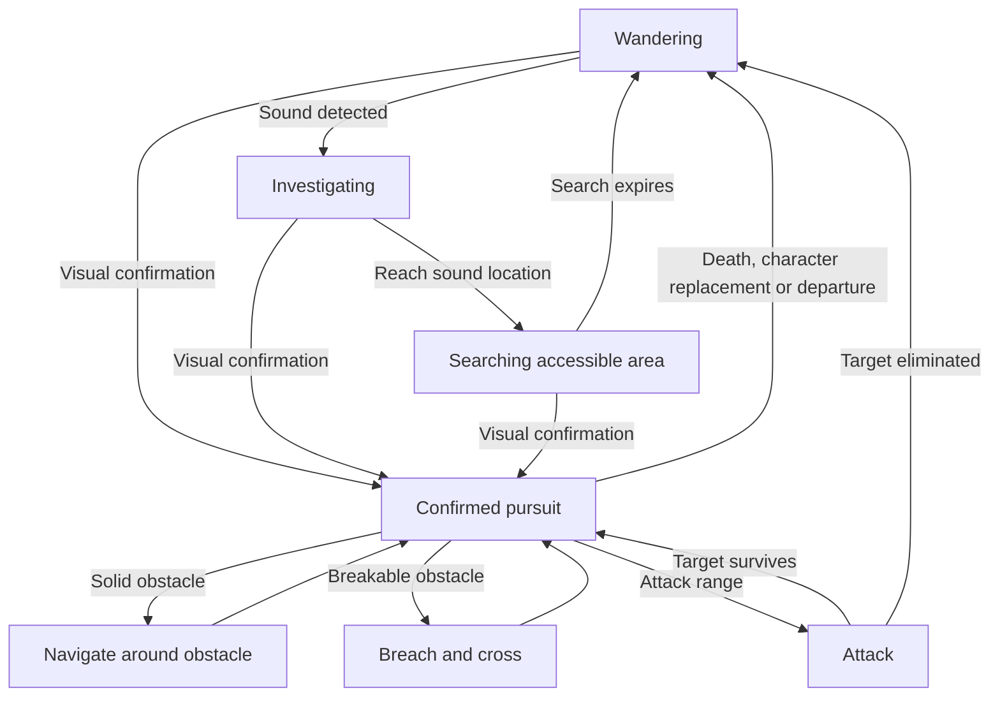

# Advanced_PathFinding_AI

    

**Advanced PathFinding AI (APFAI)** is an independent Roblox NPC intelligence framework built using vanilla Luau. It combines adaptive navigation, predictive pursuit, directional perception, sound investigation, room searching, physical wall destruction and combat in a modular, server-authoritative architecture.

Designed for horror, stealth, survival and other experiences requiring intelligent enemy NPCs.

## Portfolio and code review

This repository is a personal development portfolio by **ZakirGG**, published to showcase Roblox AI programming, software architecture, problem-solving and gameplay systems engineering. It is primarily intended for source-code review, technical evaluation, learning and experimentation, rather than as a supported plug-and-play product.

Developers, recruiters and reviewers are welcome to explore the implementation, provide feedback and use or adapt the code under the terms of the included license. The framework demonstrates independent development, modular design, asynchronous navigation, state management and server/client coordination.

> **Release status:** v1.0, production-oriented public beta. Roblox Studio acceptance testing remains pending.

## Features

| System | Functionality |

| --- | --- |

| Navigation | Hybrid direct movement and asynchronous pathfinding, bounded retries, cancellation, fallback destinations and safe route rejoining. |

| Recovery | Independent stuck detection, backward and lateral escape movements, and route rebuilding. |

| Vision | Horizontal and vertical field of view, peripheral vision, obstruction checks and sustained visual confirmation. |

| Hearing | Server-side locomotion-derived sound events, wall attenuation and explicit gameplay sound integration. |

| Investigation | Fixed sound destinations, navigation around walls and entry through accessible doorways. |

| Room search | Bounded route validation, visited and unreachable locations, pauses between search points and configurable search duration. |

| Target lock | Permanent pursuit after visual confirmation, even through occlusion or failed paths. |

| Destruction | Tagged breakable walls, physical debris, collision filtering, fragment budgets and committed breach traversal. |

| Combat | Close-range attacks, knockback, cooldowns and delayed elimination. |

| Client effects | Confirmed-target-only camera shake and red overlay with distance falloff; no FOV override. |

| Diagnostics | NPC attributes, tracebacks and bounded repeated-error handling. |

Hearing alone never activates permanent aggression, wall destruction or camera shake. The NPC cannot enter sealed rooms or automatically open closed doors. Room searching is navigation-based rather than semantic room recognition.

## Technology

- Roblox Studio — engine and gameplay testing

- Luau — implementation language

- Rojo — filesystem synchronization

- Rokit — development toolchain management

- Selene — linting

- Git — version control

## Architecture

- Modular server-side intelligence with client/server separation and shared utilities.

- Server-authoritative NPC movement; Movement owns NPC movement commands and StateMachine owns movement speed.

- Separate path planning, waypoint execution and recovery modules.

- Luau type annotations and shared type definitions; full strict interface migration is not complete.

- Shared context retained for compatibility, with private request and recovery state encapsulated in modules.

## Project structure and module reference

### Server entry points (`src/server/`)

| Script | Responsibility |

| --- | --- |

| `init.server.luau` | Server bootstrap and aggression RemoteEvent initialization. |

| `AIController.luau` | NPC initialization, module wiring, collision groups, update loop and lifecycle management. |

### AI modules (`src/server/AI/`)

| Module | Responsibility |

| --- | --- |

| `Aggression.luau` | Active aggression target and client notifications. |

| `Behavior.luau` | Main behavioral decisions and transitions. |

| `Breaching.luau` | Wall approach, destruction and crossing recovery. |

| `Combat.luau` | Attacks, knockback and delayed elimination. |

| `Configuration.luau` | Gameplay, perception, search and prediction settings. |

| `Debugger.luau` | Rate-limited diagnostic attributes. |

| `Destruction.luau` | Breakable wall validation, debris generation and cleanup. |

| `Diagnostics.luau` | Collects and publishes controller diagnostics. |

| `Hearing.luau` | Movement-derived and explicit sound events. |

| `Investigation.luau` | Investigation/search coordination and wandering behavior. |

| `Movement.luau` | Central Humanoid movement commands. |

| `Navigation.luau` | Direct movement, route planning, following and recovery coordination. |

| `ObstacleDetection.luau` | Body clearance, raycasts and ground support checks. |

| `PathPlanner.luau` | Asynchronous path requests, retries and fallback destinations. |

| `Perception.luau` | Vision, hearing and candidate detection. |

| `Prediction.luau` | Estimated future target positions. |

| `Recovery.luau` | Stuck detection and escape behavior. |

| `RoutePolicy.luau` | Shared route and recovery decision rules. |

| `Settings.luau` | Technical navigation, combat, movement and timing settings. |

| `StateMachine.luau` | State transitions and movement speeds. |

| `Targeting.luau` | Target acquisition and release. |

| `TargetMemory.luau` | Remembered positions and sensory timestamps. |

| `Utilities.luau` | Vector, distance and character helpers. |

| `Wander.luau` | Grounded roaming destinations and idle pauses. |

| `WaypointFollower.luau` | Waypoint execution, jumps and blocked-route handling. |

### Client and shared modules

| Script | Responsibility |

| --- | --- |

| `src/client/init.client.luau` | Client bootstrap placeholder. |

| `src/client/CameraEffects.client.luau` | Proximity-based camera shake and cleanup. |

| `src/client/VisualHandler.client.luau` | Aggression-dependent red overlay. |

| `src/shared/Signal.luau` | Internal event system. |

| `src/shared/Types.luau` | Shared Luau type definitions. |

The source contains 32 scripts, including 25 AI modules. Optional server features are wired into the controller; do not delete their modules without updating dependencies. Client visual effects are optional. Preserve the bootstrap hierarchy when using Rojo.

## Development scope

The supplied source uses vanilla Luau with no external runtime packages. Rojo, Rokit, Selene and Git are development tools. The project targets a single R6 NPC and is presented for technical review; integration and engine testing remain the responsibility of the user.

## NPC and map design assumptions

- `Workspace.Noob` must be a living, unanchored Humanoid rig with a HumanoidRootPart. The framework is tuned for R6 and starts one NPC controller.

- Set HumanoidRootPart.CanCollide to false for a standard rig. Avoid competing movement scripts, BodyMovers or CFrame animations.

- Ground must be anchored and collidable. Start with corridors at least 5–6 studs wide; actual navigation depends on rig and map clearance.

- Breakable walls must be anchored, collidable rectangular Parts tagged `Breakable`, not MeshParts. A `Breakable=false` attribute vetoes destruction. Untagged walls remain solid.

- `NoobAICharacter` and `NoobWallDebris` collision groups are registered automatically. Debris is intended to collide with the environment but not the NPC; `PathfindingModifier.PassThrough` marks fragments for navigation. Verify these interactions in Studio.

- Debris limits are 64 fragments per wall and 192 globally in the base release.

## Behavioral lifecycle



Confirmed pursuit persists through temporary missing character components, occlusion and failed routes. Inaccessible geometry may require retries; no teleportation or clipping is promised.

## Configuration

Edit `src/server/AI/Settings.luau` for technical navigation, movement, combat, debris, recovery and timing parameters. Edit `Configuration.luau` for perception, wandering, investigation and prediction.

The latest advanced room-search patch uses these configurable defaults:

```lua

InvestigationTimeout = 45,

SearchDuration = 40,

SearchRadius = 24,

SearchPause = 0.8,

SearchMinStep = 3,

SearchRetry = 0.6,

SearchRouteTimeout = 12,

SearchRouteBudget = 65,

```

Search routes are intended to stay within the search radius, respect obstacles and avoid jumps. Investigation can navigate around walls to reach the original noise location. Set the player attribute `ReduceCameraShake` to opt out of camera shake.

## Sound integration

Automatic sounds are inferred from server-side locomotion velocity/displacement, moving-platform compensation and jump/landing transitions. They are not measurements of actual audio playback.

Trusted server-side gameplay code can emit a sound event, for example a door slam:

```lua

local Hearing = require(game:GetService("ServerScriptService").Server.AI.Hearing)

Hearing.Emit(player.Character, door.Position, 35)

```

The event radius is capped at 40 studs. Do not expose `Emit` through an unvalidated client RemoteEvent.

Fully transparent geometry is ignored for vision unless `AI_VisionTransparent=false`. Set the attribute to true to mark a queryable part as visually transparent. Non-queryable geometry cannot block vision.

## Diagnostics

Inspect the following attributes on `Workspace.Noob` in the server view:

| Category | Attributes |

| --- | --- |

| Behavior | `AI_State`, `AI_Mode`, `AI_LastDecision` |

| Target | `AI_ConfirmedTarget`, `AI_AggroUserId`, `AI_Target`, `AI_CanSee`, `AI_CanHear` |

| Pathfinding | `AI_PathStatus`, `AI_ComputingPath`, `AI_FailedPaths`, `AI_RouteDestination` |

| Recovery | `AI_RecoveryActive`, `AI_RecoveryAttempts`, `AI_NavigationStuckTime` |

| Movement | `AI_MoveGoal`, `AI_ActualSpeed`, `AI_WalkSpeed`, `AI_BreachTraversing` |

| Errors | `AI_ErrorCount`, `AI_LastError`, `AI_PathError`, `AI_DebugError` |

LastError and PathError are historical within the controller lifetime. ErrorCount tracks consecutive controller update errors. Five consecutive errors halt movement and mark the controller Faulted; inspect the traceback to diagnose the cause.

## Testing and validation

The repository includes three testing resources for technical review:

| File | Purpose |
| --- | --- |
| `tests/STUDIO_ACCEPTANCE.md` | Manual Roblox Studio gameplay and engine acceptance checklist. |
| `tests/check_source.py` | Static source, dependency, configuration and movement ownership validation. |
| `tests/offline_regression.lua` | Mocked regression testing of core AI behavior. |

The base v1.0 release recorded 26 passing mocked regression scenarios. These historical results do not establish coverage of the later room-search patch or the current reduced repository.

Offline tests simulate Roblox APIs, not actual navigation meshes, Humanoid physics, replication or rendering. Full Luau compilation, type checking, live profiling and Roblox Studio acceptance remain pending. Custom maps and camera controllers may require adaptation. The framework targets a single NPC and is not certified production-ready.

## Ownership and license

**Copyright © 2026 ZakirGG. All rights reserved.**

APFAI is source-available under a custom license. You may review, learn from, use and modify the code, including incorporating it into your own Roblox experiences (including monetized experiences), with attribution. You may share it free of charge under the same license and with the original notices intact.

You may not sell, sublicense for payment, or commercially redistribute the framework or its derivatives as source code, a standalone asset, plugin, template or code package. You may not claim authorship of the original work or remove its ownership notices. This is not an OSI-approved open-source license. See [LICENSE.txt](LICENSE.txt) for the full terms.

`RELEASE_METADATA.json` records release and ownership information. Embedded source identifiers were added during rebranding and do not independently prove historical authorship.

## Contact

- **Developer:** ZakirGG

- **Discord:** `zakir_playz_`

- **GitHub:** [Nekoraiiii](https://github.com/Nekoraiiii)
