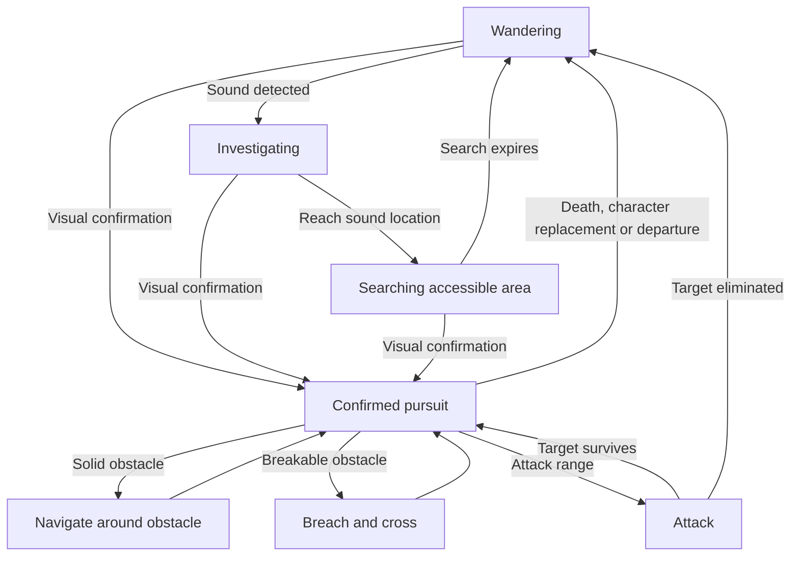

# Advanced PathFinding AI (APFAI)


**Advanced PathFinding AI (APFAI)** is an independent Roblox NPC intelligence framework built using vanilla Luau. It combines adaptive navigation, predictive pursuit, directional perception, sound investigation, room searching, physical wall destruction and combat in a modular, server-authoritative architecture.

Designed for horror, stealth, survival and other experiences requiring intelligent enemy NPCs.

---

## Live Playable Demo

[](https://www.roblox.com/games/100606153389681/Advanced-PathFinding-AI-1-0-System)

**[Launch Advanced PathFinding AI v1.0 on Roblox](https://www.roblox.com/games/100606153389681/Advanced-PathFinding-AI-1-0-System)**

Experience the framework directly through an interactive Roblox demonstration. Visitors can explore the test environment and observe the NPC's intelligent behavior in real time.

The playable demonstration is intended to showcase:

- Footstep detection and sound investigation
- Autonomous navigation and room searching
- Directional vision and visual target acquisition
- Persistent pursuit and obstacle avoidance
- Dynamic wall destruction and breach traversal
- Combat, physical knockback and client-side visual effects

> This experience is a technical demonstration of the AI framework rather than a complete game.

---

## Portfolio and Code Review

This repository is a personal development portfolio by **ZakirGG**, published to showcase Roblox AI programming, software architecture, problem-solving and gameplay systems engineering.

It is primarily intended for source-code review, technical evaluation, learning and experimentation rather than as a supported plug-and-play product.

Developers, recruiters and reviewers are welcome to explore the implementation, provide feedback and use or adapt the code under the terms of the included license.

The framework demonstrates independent development, modular design, asynchronous navigation, state management and server/client coordination.

> **Release status:** v1.0 — Public Beta.
>
> All 26 offline regression scenarios passed, static source validation passed, and practical gameplay testing was performed in Roblox Studio.

---

## Gameplay Demonstrations

The following gameplay recordings demonstrate the framework's core AI systems operating in real time within Roblox Studio.

### Demo 01 — Footstep Detection & Sound Investigation

This demonstration showcases the NPC's hearing and investigation systems. The NPC detects movement-generated footsteps, remembers the source location and navigates toward the area to investigate the potential presence of a player.

Unlike visually confirmed pursuit, sound-based investigation does not immediately activate aggressive behavior.

**Systems demonstrated:**

- Movement-based sound detection
- Sound perception without direct visual contact
- Sound-source memory
- Autonomous navigation
- Non-aggressive investigation behavior

https://github.com/user-attachments/assets/acd8a99f-2dae-4478-b761-a6ad5fd343e9

### Demo 02 — Persistent Pursuit & Dynamic Wall Destruction

This demonstration showcases the NPC's aggressive behavior following visual target confirmation.

The NPC maintains pursuit of the player, detects breakable obstacles, dynamically destroys walls and continues chasing through the resulting opening.

**Systems demonstrated:**

- Visual target acquisition
- Persistent target tracking
- Adaptive pursuit and navigation
- Dynamic wall destruction
- Physical debris generation
- Breach traversal

https://github.com/user-attachments/assets/656c4841-4c7d-4d27-a6b3-7e958cb12607

### Additional Gameplay Footage

https://github.com/user-attachments/assets/c615fcdc-99b3-4185-b51f-9b5945839cd7

### Development Note

This framework was developed within a short timeframe as a technical portfolio project focused primarily on AI programming, behavioral logic, navigation, physics interactions and modular software architecture.

**No character animations were implemented or used in these demonstrations.**

The NPC's movements and interactions are intentionally presented without animation polish, as the primary objective was to demonstrate the underlying AI systems rather than visual presentation.

All gameplay demonstrations were recorded directly in Roblox Studio.

---

## Features

| System | Functionality |
| --- | --- |
| Navigation | Hybrid direct movement and asynchronous pathfinding, bounded retries, cancellation, fallback destinations and safe route rejoining. |
| Recovery | Independent stuck detection, backward and lateral escape movements, and route rebuilding. |
| Vision | Horizontal and vertical field of view, peripheral vision, obstruction checks and sustained visual confirmation. |
| Hearing | Server-side locomotion-derived sound events, wall attenuation and explicit gameplay sound integration. |
| Investigation | Fixed sound destinations, navigation around walls and entry through accessible doorways. |
| Room search | Bounded route validation, visited and unreachable locations, pauses between search points and configurable search duration. |
| Target lock | Persistent pursuit after visual confirmation, even through occlusion or failed paths. |
| Destruction | Tagged breakable walls, physical debris, collision filtering, fragment budgets and committed breach traversal. |
| Combat | Close-range attacks, knockback, cooldowns and delayed elimination. |
| Client effects | Confirmed-target-only camera shake and red overlay with distance falloff; no FOV override. |
| Diagnostics | NPC attributes, tracebacks and bounded repeated-error handling. |

Hearing alone never activates permanent aggression, wall destruction or camera shake.

The NPC cannot enter sealed rooms or automatically open closed doors. Room searching is navigation-based rather than semantic room recognition.

---

## Technology

- **Roblox Studio** — Engine and gameplay testing
- **Luau** — Implementation language
- **Rojo** — Filesystem synchronization
- **Rokit** — Development toolchain management
- **Selene** — Static linting configuration
- **Git** — Version control
- **Python** — Automated source validation
- **Lua 5.5.0** — Offline regression testing

The framework uses vanilla Luau with no external runtime packages.

---

## Architecture

- Modular server-side intelligence with client/server separation and shared utilities.
- Server-authoritative NPC movement.
- Movement owns NPC movement commands, while StateMachine owns movement speed.
- Separate path planning, waypoint execution and recovery modules.
- Asynchronous pathfinding with bounded retries and request cancellation.
- Luau type annotations and shared type definitions.
- Shared context retained for compatibility, with private request and recovery state encapsulated in modules.
- Centralized configuration and technical settings.
- Diagnostic attributes for observing internal AI behavior.

Full strict interface migration is not complete.

---

## Project Structure

```text
Advanced_PathFinding_AI/
│
├── src/
│   ├── client/
│   │   ├── CameraEffects.client.luau
│   │   ├── VisualHandler.client.luau
│   │   └── init.client.luau
│   │
│   ├── server/
│   │   ├── AI/
│   │   │   └── 25 dedicated AI modules
│   │   ├── AIController.luau
│   │   └── init.server.luau
│   │
│   └── shared/
│       ├── Signal.luau
│       └── Types.luau
│
├── tests/
│   ├── check_source.py
│   ├── offline_regression.lua
│   └── STUDIO_ACCEPTANCE.md
│
├── .gitignore
├── default.project.json
├── LICENSE.txt
├── README.md
├── RELEASE_METADATA.json
├── rokit.toml
└── selene.toml
```

### Project Statistics

| Metric | Value |
| --- | --- |
| Version | 1.0 |
| Release status | Public Beta |
| Luau source files | 32 |
| Dedicated AI modules | 25 |
| External runtime dependencies | 0 |
| Offline regression scenarios | 26 |
| Passing regression scenarios | 26/26 |
| Static source validation | Passed |
| Roblox Studio gameplay testing | Performed |
| Playable demonstration | Available |

---

## Module Reference

### Server Entry Points (`src/server/`)

| Script | Responsibility |
| --- | --- |
| `init.server.luau` | Server bootstrap and aggression RemoteEvent initialization. |
| `AIController.luau` | NPC initialization, module wiring, collision groups, update loop and lifecycle management. |

### AI Modules (`src/server/AI/`)

| Module | Responsibility |
| --- | --- |
| `Aggression.luau` | Active aggression target and client notifications. |
| `Behavior.luau` | Main behavioral decisions and transitions. |
| `Breaching.luau` | Wall approach, destruction and crossing recovery. |
| `Combat.luau` | Attacks, knockback and delayed elimination. |
| `Configuration.luau` | Gameplay, perception, search and prediction settings. |
| `Debugger.luau` | Rate-limited diagnostic attributes. |
| `Destruction.luau` | Breakable wall validation, debris generation and cleanup. |
| `Diagnostics.luau` | Collects and publishes controller diagnostics. |
| `Hearing.luau` | Movement-derived and explicit sound events. |
| `Investigation.luau` | Investigation/search coordination and wandering behavior. |
| `Movement.luau` | Central Humanoid movement commands. |
| `Navigation.luau` | Direct movement, route planning, following and recovery coordination. |
| `ObstacleDetection.luau` | Body clearance, raycasts and ground support checks. |
| `PathPlanner.luau` | Asynchronous path requests, retries and fallback destinations. |
| `Perception.luau` | Vision, hearing and candidate detection. |
| `Prediction.luau` | Estimated future target positions. |
| `Recovery.luau` | Stuck detection and escape behavior. |
| `RoutePolicy.luau` | Shared route and recovery decision rules. |
| `Settings.luau` | Technical navigation, combat, movement and timing settings. |
| `StateMachine.luau` | State transitions and movement speeds. |
| `Targeting.luau` | Target acquisition and release. |
| `TargetMemory.luau` | Remembered positions and sensory timestamps. |
| `Utilities.luau` | Vector, distance and character helpers. |
| `Wander.luau` | Grounded roaming destinations and idle pauses. |
| `WaypointFollower.luau` | Waypoint execution, jumps and blocked-route handling. |

### Client and Shared Modules

| Script | Responsibility |
| --- | --- |
| `src/client/init.client.luau` | Client bootstrap placeholder. |
| `src/client/CameraEffects.client.luau` | Proximity-based camera shake and cleanup. |
| `src/client/VisualHandler.client.luau` | Aggression-dependent red overlay. |
| `src/shared/Signal.luau` | Internal event system. |
| `src/shared/Types.luau` | Shared Luau type definitions. |

The source contains 32 scripts, including 25 AI modules.

Optional server features are wired into the controller; do not delete their modules without updating dependencies. Client visual effects are optional.

Preserve the bootstrap hierarchy when using Rojo.

---

## Development Scope

The supplied source uses vanilla Luau with no external runtime packages. Rojo, Rokit, Selene and Git are development tools.

The project targets a single R6 NPC and is presented for technical review. Integration and additional engine testing remain the responsibility of the user.

The framework prioritizes:

- Intelligent NPC behavior
- Modular software architecture
- Navigation reliability
- Movement ownership
- Sensory perception
- Behavioral state management
- Dynamic environmental interactions
- Maintainability and configurability

Character animation, artistic assets, environmental design and complete game development were outside the primary scope of this short-duration project.

---

## NPC and Map Design Assumptions

- `Workspace.Noob` must be a living, unanchored Humanoid rig with a HumanoidRootPart. The framework is tuned for R6 and starts one NPC controller.
- Set `HumanoidRootPart.CanCollide` to false for a standard rig. Avoid competing movement scripts, BodyMovers or CFrame animations.
- Ground must be anchored and collidable. Start with corridors at least 5–6 studs wide; actual navigation depends on rig and map clearance.
- Breakable walls must be anchored, collidable rectangular Parts tagged `Breakable`, not MeshParts.
- A `Breakable=false` attribute vetoes destruction. Untagged walls remain solid.
- `NoobAICharacter` and `NoobWallDebris` collision groups are registered automatically.
- Debris is intended to collide with the environment but not the NPC.
- `PathfindingModifier.PassThrough` marks fragments for navigation. Verify these interactions in Studio.
- Debris limits are 64 fragments per wall and 192 globally in the base release.

---

## Behavioral Lifecycle



Confirmed pursuit persists through temporary missing character components, occlusion and failed routes.

Inaccessible geometry may require retries; no teleportation or clipping is promised.

---

## Configuration

Edit `src/server/AI/Settings.luau` for technical navigation, movement, combat, debris, recovery and timing parameters.

Edit `src/server/AI/Configuration.luau` for perception, wandering, investigation and prediction.

### Advanced Room Search Configuration

The advanced room-search implementation uses the following configurable defaults:

```lua
InvestigationTimeout = 45,
SearchDuration = 40,
SearchRadius = 24,
SearchPause = 0.8,
SearchMinStep = 3,
SearchRetry = 0.6,
SearchRouteTimeout = 12,
SearchRouteBudget = 65,
```

Search routes are intended to stay within the search radius, respect obstacles and avoid jumps.

Investigation can navigate around walls to reach the original noise location.

Set the player attribute `ReduceCameraShake` to opt out of camera shake.

---

## Sound Integration

Automatic sounds are inferred from server-side locomotion velocity/displacement, moving-platform compensation and jump/landing transitions.

They are not measurements of actual audio playback.

Trusted server-side gameplay code can emit a sound event, for example a door slam:

```lua
local Hearing = require(
    game:GetService("ServerScriptService").Server.AI.Hearing
)

Hearing.Emit(player.Character, door.Position, 35)
```

The event radius is capped at 40 studs.

Do not expose `Emit` through an unvalidated client RemoteEvent.

Fully transparent geometry is ignored for vision unless `AI_VisionTransparent=false`.

Set the attribute to true to mark a queryable part as visually transparent. Non-queryable geometry cannot block vision.

---

## Diagnostics

Inspect the following attributes on `Workspace.Noob` in the server view:

| Category | Attributes |
| --- | --- |
| Behavior | `AI_State`, `AI_Mode`, `AI_LastDecision` |
| Target | `AI_ConfirmedTarget`, `AI_AggroUserId`, `AI_Target`, `AI_CanSee`, `AI_CanHear` |
| Pathfinding | `AI_PathStatus`, `AI_ComputingPath`, `AI_FailedPaths`, `AI_RouteDestination` |
| Recovery | `AI_RecoveryActive`, `AI_RecoveryAttempts`, `AI_NavigationStuckTime` |
| Movement | `AI_MoveGoal`, `AI_ActualSpeed`, `AI_WalkSpeed`, `AI_BreachTraversing` |
| Errors | `AI_ErrorCount`, `AI_LastError`, `AI_PathError`, `AI_DebugError` |

LastError and PathError are historical within the controller lifetime.

ErrorCount tracks consecutive controller update errors.

Five consecutive errors halt movement and mark the controller Faulted; inspect the traceback to diagnose the cause.

---

## Testing and Validation

The framework has undergone automated source validation, offline regression testing and practical gameplay testing in Roblox Studio.

### Validation Results

| Validation | Result |
| --- | --- |
| Offline regression testing | 26/26 passed |
| Static source validation | Passed |
| Luau source files validated | 32 |
| Dedicated AI modules | 25 |
| Referenced AI module names | 25 |
| Configuration reference validation | Passed |
| Context reference validation | Passed |
| Movement ownership validation | Passed |
| Regression interpreter | Lua 5.5.0 |
| Roblox Studio gameplay testing | Performed |
| Public playable demonstration | Available |

### Testing Resources

| File | Purpose |
| --- | --- |
| [`tests/STUDIO_ACCEPTANCE.md`](tests/STUDIO_ACCEPTANCE.md) | Manual Roblox Studio gameplay and engine acceptance checklist. |
| [`tests/check_source.py`](tests/check_source.py) | Static source, dependency, configuration and movement ownership validation. |
| [`tests/offline_regression.lua`](tests/offline_regression.lua) | Mocked regression testing of core AI behavior. |

### Static Source Validation

```text
PASS 32 source files, 25 AI modules, 25 referenced module
names, configuration keys, context references and
movement ownership.

Static name checks are not type checking or runtime
verification.
```

### Offline Regression Results

```text
PASS retry is bounded and increases
PASS target lock lifetime does not depend on perception
PASS direct movement, no path request, arrival stops
PASS blocked target cannot be falsely marked arrived
PASS path waypoints followed, forward blocked event invalidates
PASS cancellation invalidates suspended request
PASS path timeout is bounded and releases worker
PASS fallback keeps actual endpoint and rotates on completion
PASS recovery runs during pending path and owns escape
PASS recovery executes during no-path retry cooldown
PASS moving route accepts safe forward join rather than stale second waypoint
PASS jump delegated to movement and not repeated at same waypoint
PASS hearing through a wall is separate from vision
PASS hearing remembers fixed sound after player stops
PASS vision cone, transparent visual geometry and rear rejection
PASS confirmed chase continues without vision or hearing
PASS temporary missing root does not release target
PASS confirmed death and respawn release target
PASS hearing investigation never activates aggression or breach
PASS wall crossing shortens exit when the next solid wall is near
PASS breaching is prohibited before visual confirmation
PASS failed crossing returns to chase without unlocking target
PASS movement refresh and steering handoff
PASS visual confirmation requires sustained sight and cannot switch locked player
PASS trusted server sound event is audible without movement
PASS moving platform does not generate stationary footstep noise

All 26 regression scenarios passed.
Roblox API calls were mocked; no physics or engine validation.
```

### Running the Tests

Static source validation:

```bash
python tests/check_source.py
```

Offline regression testing using Lua 5.3 or newer:

```bash
lua tests/offline_regression.lua
```

### Testing Limitations

Offline tests execute actual Lua-compatible core modules using mocked Roblox API objects.

They do not simulate actual Roblox navigation meshes, Humanoid physics, network replication or rendering.

The advanced room-search implementation does not yet have dedicated offline regression coverage.

Practical gameplay testing has been performed in Roblox Studio, with recorded demonstrations and a publicly playable experience available for evaluation.

Full formal engine acceptance testing, comprehensive Luau type checking and live performance profiling have not been certified.

---

## Known Limitations

- Designed and configured for a single R6 NPC.
- No character animations were implemented for the demonstration.
- Multi-NPC scalability has not been formally benchmarked.
- Room searching is navigation-based rather than semantic room recognition.
- The NPC cannot enter completely sealed rooms.
- Automatic closed-door interaction is not implemented.
- Wall destruction requires supported rectangular Parts.
- Custom maps and camera controllers may require adaptation.
- Full production readiness is not certified.

These limitations reflect the technical scope of the project and its public beta status.

---

## Ownership and License

**Copyright © 2026 ZakirGG. All rights reserved.**

Advanced PathFinding AI is source-available under a custom license.

### Permitted Usage

Subject to the included license, you may:

- Review and study the source code.
- Use the framework for learning and experimentation.
- Modify and adapt the implementation.
- Incorporate the framework into your own Roblox experiences, including monetized experiences, with attribution.
- Share the framework free of charge under the same license and with the original notices intact.

### Prohibited Usage

You may not:

- Sell the framework or its derivatives as source code.
- Sublicense the framework for payment.
- Commercially redistribute it as a standalone asset, plugin, template or code package.
- Claim authorship of the original work.
- Remove the original copyright or ownership notices.

This is not an OSI-approved open-source license.

See [LICENSE.txt](LICENSE.txt) for the complete and authoritative license terms.

`RELEASE_METADATA.json` records release and ownership information.

Embedded source identifiers were added during rebranding and do not independently prove historical authorship.

---

## Contact

**Developer:** ZakirGG

**Discord:** `zakir_playz_`

**GitHub:** [Nekoraiiii](https://github.com/Nekoraiiii)

**Playable Experience:** [Advanced PathFinding AI v1.0](https://www.roblox.com/games/100606153389681/Advanced-PathFinding-AI-1-0-System)

---

<div align="center">

### Advanced PathFinding AI

**Intelligent Behavior. Adaptive Navigation. Modular Architecture.**

Developed by **ZakirGG**

[](https://www.roblox.com/games/100606153389681/Advanced-PathFinding-AI-1-0-System)
[](https://github.com/Nekoraiiii)

Copyright © 2026 ZakirGG. All rights reserved.

</div>
